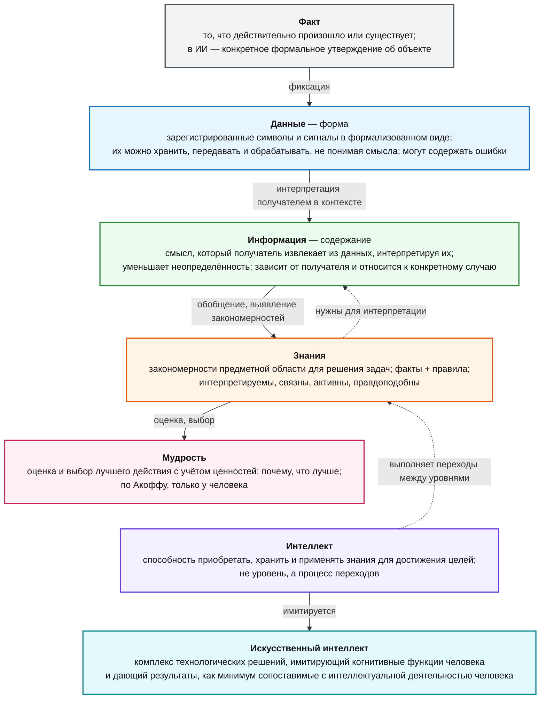

# Факт → данные → информация → знания → мудрость; интеллект

**Источники определений:**

- Данные, информация — ISO/IEC 2382 (по вторичным цитатам: [Squoring](https://support.squoring.com/documentation/16.3/reference_manual/ch07s73.html)); информация в праве РФ — [149-ФЗ, ст. 2](https://normativ.kontur.ru/document/1/504575-federalnyy-zakon-ot-27-07-2006-n-149-fz)
- Иерархия DIKW, мудрость — Акофф, 1989 ([ISKO](https://isko.org/cyclo/dikw))
- Знания, свойства знаний — инженерия знаний, Д. А. Поспелов ([studfile](https://studfile.net/preview/1529919/))
- Интеллект — Маккарти ([whatisai.pdf](https://www-formal.stanford.edu/jmc/whatisai.pdf))
- ИИ — Указ № 490, ГОСТ Р 59277-2020 ([Гарант](https://base.garant.ru/408559959))
